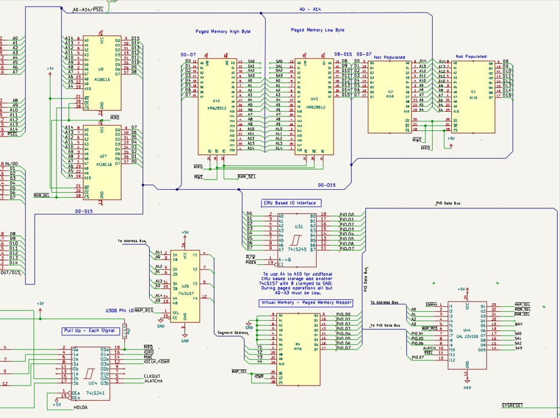
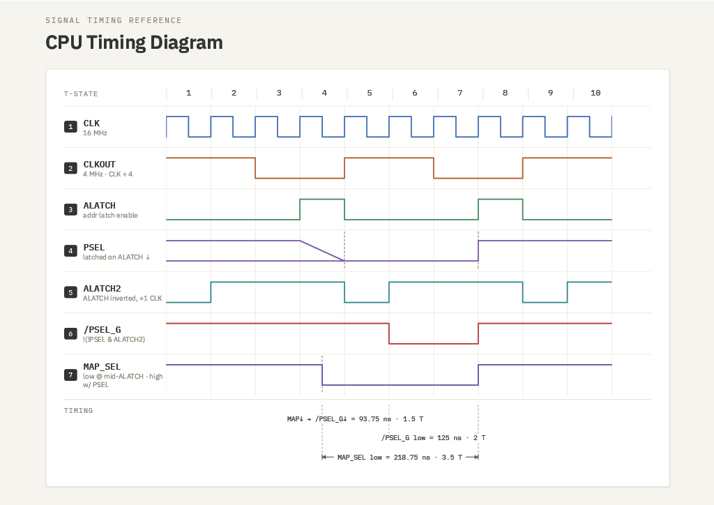
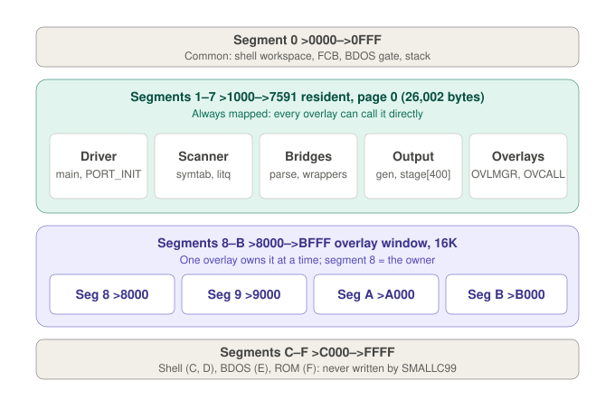
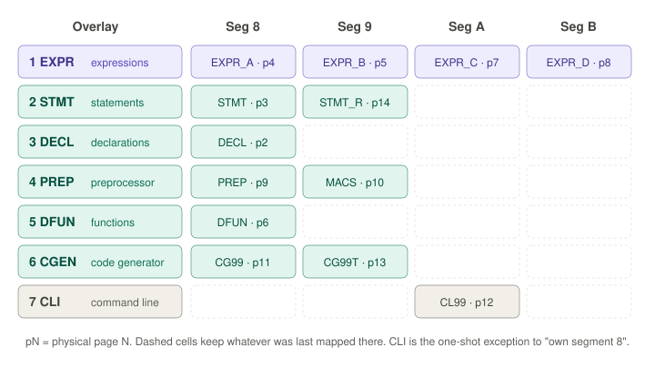

# TMS99105 SBC Transparent Paged Memory

This document describes the memory mapper on the TMS99105 SBC in three parts:

1. [The memory mapper](#part-1--the-memory-mapper) — what it does, and the hardware that does it
2. [Example: the SMALLC99 compiler](#part-2--example-the-smallc99-compiler) — how a large program uses it
3. [Programming and using the mapper](#part-3--programming-and-using-the-mapper) — the instructions, file format, linker and overlay manager

## Part 1 — The memory mapper

### How it works

The TMS99105 can address only 64K bytes. This SBC's memory mapper lets it use
far more physical memory than that, by swapping blocks of memory in and out of
the 64K address space as a program needs them.

The address space is divided into sixteen **segments** of 4K each: segment 0
is `>0000`–`>0FFF`, segment 1 is `>1000`–`>1FFF`, and so on up to segment F at
`>F000`. Behind every segment sit sixteen physical **pages** of 4K, and a
small **map register** for each segment says which of its pages the CPU
currently sees there. The mapper supplies the page number on extra high
address lines (SA0–SA3), so changing one map register changes what appears in
that one 4K segment and nothing else. Sixteen segments with sixteen pages each
gives 1MB of physical memory in total.

Page 0 behind every segment, taken together, is the ordinary flat 64K the
system boots with. Mapping is switched on and off as a whole by **PSEL**: with
PSEL off, every segment shows page 0; with PSEL on, each segment shows the page
its map register names.

Deciding which page belongs in which segment, and switching them at the right
moments, is the job of an **overlay manager**.

### Memory Mapper Schematic

Most designs would just add a 74LS612 memory mapper, but you can build your own
with just a 74LS157 multiplexer and a 6116 2K memory chip. The 74LS157
multiplexes the different address lines depending on the state the memory
mapper is in. There are two states: one where the memory chip is programmed
with the segment pages, and the other where it outputs the page number for a
given segment on the upper address lines SA0 to SA3. For example, the third
memory address holds the page number for segment 2 (`>2000`–`>2FFF`); this page
number can change when you need to swap in another page. For this to be useful
you must of course have physical memory much larger than the 64K bytes the CPU
can address.  In our case you can see that the memory chips being used are HN62B512 
512K bytes resulting in the memory mapper segments each having access to 16 pages of 4k,
or in total 16 segments * 16 pages * 4k bytes or 1M bytes of memory. 

<p align="center">
    
</p>

*Schematic showing the GAL22V10 (U44) page mapper, 6116 mapper RAM (IC4),
74LS157 segment address multiplexer (U26), and CRU interface (U31). Note: when
PSEL_G is high, SA0–SA3 are forced low — all segments map to physical page 0.*

### Page Mapper Timing

The key design criterion for this memory mapper is to ensure that the addresses
have enough time to get from the 6116 to the GAL during the memory cycle. This
is done by allowing the true PSEL (from the CPU, which derives MAP_SEL) to
enable the 6116 as soon as ALATCH goes high, and by using it to derive a
secondary PSEL_G signal that is delayed by one 16MHz clock cycle relative to
the falling edge of the true PSEL. This is achieved by clocking PSEL with an
inverted ALATCH signal inside the GAL. Thus while PSEL_G is high the paged
address lines are clamped low, and they become valid once PSEL_G goes low.



### Hardware — GAL22V10 Page Mapper

The SBC uses a GAL22V10 (U44) as a page mapper providing:

- 16 virtual segments × 4KB = 64KB virtual address space
- 16 physical pages behind each segment: 16 segments × 16 pages × 4KB = 1MB physical RAM
- CRU-based programming via `LDCR`/`STCR` at `MAP_WIN_BASE = 0x80C0`
- PSEL controlled via ST7 in the status register (set by the PSEL XOPs)

### How the address space is used

As used by Shell 6.5:

```
0x0000-0x00AF  Interrupt Vectors (7 user vectors at 0x00B0)
0x00B0-0x012F  Interrupt Workspace (8 x 16 bytes)
0x0130-0x022F  XOP Workspace (16 x 16 bytes)
0x0230-0x024F  Shell workspace (R0-R15)
0x0250         Command line (64 characters)
0x0280         Common FCB
0x02A0-0x02E7  Shell overlay variables (OVL_PRINT_VEC at 0x02A0)
0x02E8         LGATE - launch gate:  PSEL on, branch to program
0x02F0         RGATE - return gate:  PSEL off, back to the shell
0x02F6         BGATE - BDOS gate:    PSEL off, call BDOS, PSEL on
0x0300-0x04FF  Loader area / sector buffer (free RAM after EXE launch)
0x0500-0x08FF  EXE staging buffer (two sectors, 0x400 bytes)
0x0900-0x0FFF  Free RAM (stack grows down from 0x0FFE)
0x1000-0xBFFF  TPA - Paged Program Area (page 0 by default); a .COM may
               also use 0xC000-0xDFFF, which the shell swaps to page 1
0xC000         SHELL core (0xC000-0xD911), page 0
0xD000         Shell command window: DIR, TYPE, ERA ... each on its own
               page of segment D, pages 2-10
0xE000         BDOS
0xF000         ROM / DISC_MONITOR
```

Pages behind segments C and D:

| Page | Segment C | Segment D |
|------|-----------|-----------|
| 0 | the shell | the shell |
| 1 | the shell's private page for a `.COM` run | the same |
| 2–10 | free while an EXE runs | **the shell's internal commands** — never write these |
| 11–15 | free while an EXE runs | free while an EXE runs |

The area `0x02A0`–`0x02FF` belongs to the shell. Applications must not store
anything there (see [Rules](#rules)).

## Part 2 — Example: the SMALLC99 compiler

[SMALLC99](https://github.com/AlexanderAdelAU/SmallC99-TMS99105-Native-C-Compiler)
is a Small-C compiler that runs on the SBC itself. It is the largest program
using the mapper, and it uses it through **OVL99**, the overlay system shared
with FileEdit and the SBC's own linker. This part describes what goes where and
why. The reference for OVL99 itself — the runtime, the table, the map format
and all the rules — is
[OVL99.md](https://github.com/AlexanderAdelAU/TMS99105-Native-Toolchain/blob/main/OVL99.md).

### Why it needs the mapper

SMALLC99 is far too big to fit in 64K alongside the shell and the BDOS, so it
is built as one **resident** part that is always present, plus eight
**overlays** that take turns in a shared 16K **overlay window**.

<p align="center">
  
</p>

| Region | Contents |
|---|---|
| Segment 0 | Common memory: the shell's workspace, the FCB, the gates and the stack. Always page 0, whatever PSEL says |
| Segments 1–7 (`>1000`–`>7591`) | The resident compiler in page 0. These map registers stay at 0, so the resident code is visible whether PSEL is on or off |
| `>7592`–`>7FFF` | The C run-time heap (file buffers) |
| Segments 8–B (`>8000`–`>BFFF`) | The overlay window. Whichever overlay is active has its pages mapped here |
| Segments C–F | The shell, the BDOS and the ROM. The loader refuses to put any program code there |

### What the parts of a compiler do

A C compiler reads source text and writes assembly language. SMALLC99 does this
in the classic single-pass way: it reads a declaration or function, parses it,
and emits code for it straight away. The work falls into a few jobs, and each
overlay does one of them:

| Overlay | Stands for | What it compiles or does | Example source it handles |
|---------|-----------|--------------------------|---------------------------|
| 1 `EXPR` | **Expressions** | Operators, precedence, assignments, function calls, member access, constants | `a = b + f(c) * 2` |
| 2 `STMT` | **Statements** | Control flow: `if`, `while`, `do`, `for`, `switch`/`case`, `return`, `break`, `goto`, compound `{ }` blocks, local declarations | `if (x > 0) y = 1;` |
| 3 `DECL` | **Declarations** | Global and static variable declarations and their initial values | `int count; char buf[80];` |
| 4 `PREP` | **Preprocessor** | Reading source lines, `#define`, `#include`, `#if`/`#ifdef`, `#asm`, macro expansion | `#define TEN 10` |
| 5 `DFUN` | **Define function** | A function definition: its header, arguments and parameter declarations, then its body | `add(a, b) int a, b; { ... }` |
| 6 `CGEN` | **Code generator** | Turns the compiler's internal operation codes into TMS9900 assembly text | (produces `MOV`, `A`, `BL` … lines) |
| 7 `CLI` | **Command-line interface** | Reads the command line (source and output names, `-V` and other options) and reports errors | `SMALLC99 TEST -V` |
| 8 `STRD` | **Struct declarations** | `struct`/`union` tags and member lists | `struct pt { int x, y; };` |

The resident part holds everything the overlays share:

| Resident module | What it does |
|-----------------|--------------|
| `SMALLC99.C` | The driver: `main()` calls the CLI, opens the files, runs the parse loop and closes up |
| `CC_PORT.A99` | Startup: initialises the overlay manager and the OVL99 frame stack in the right order |
| `CC_RESIDENT.C` | The top-level parse loop, and the **bridge** functions overlays call to reach each other |
| `CC_SCAN_SYM.C` | The scanner, symbol table search and insertion |
| `CC_DATA.C` | Shared data: the symbol table, literal pool (`litq`), operator tables, file units |
| `CC_CD99.C` | The output layer: `gen()` and the p-code staging buffer (`stage`, 400 words), module header and trailer |
| `OVLMGR.A99` | The overlay manager: maps one row of `OVL_TABLE` |
| `OVCALL.A99` | The OVL99 call gate: the only code that switches overlays mid-compile |
| `SPYOUT.A99` | Low-level text output (`pstr`, `pchar`, `pdec` …) |
| `CC_STRU.A99` | `elsize()`, the size of a struct element |
| `OVLGLUE.R99` | Written by the linker: `OVL_TABLE` and one 12-byte thunk per published entry |

A **p-code** is one of the compiler's internal operation codes, such as "load
a word from the stack" or "add the two working registers". The expression and
statement code calls `gen(pcode, value)` to record what it wants done; the
code generator later turns each p-code into real assembly lines.

### The overlay table

Each overlay has a row in `OVL_TABLE` listing which physical page to map into
each window segment. Nobody writes the table by hand: the linker builds it from
one declaration file, `OVLMAP.TXT`, with `link99 -YOVLMAP.TXT`:

```
# module    page  overlay  entries
CC_EXPR_A    4    EXPR     R_EXPR=expression R_EXPRVAL=expression R_CEXPR=constexpr
CC_EXPR_B    5    EXPR     R_TEST=test
CC_EXPR_C    7    EXPR     -
CC_EXPR_D    8    EXPR     -
CC_STMT      3    STMT     R_STMT=statement
CC_STMT_R   14    STMT     -
CC_DECL      2    DECL     R_DODECL=dodeclare:tail
...
CC_CL99     12    CLI      R_GETOPTS=getoptions R_ERROR=errrep
CC_STRD     15    STRD     R_STRUCT=dostruct
guest CLI
```

Each line is one module: its physical page, the overlay it belongs to, and the
entries other overlays may call. The segment is not in the map — it comes from
the module's own `AORG` (`>8000` for segment 8, and so on). The result:

<p align="center">
  
</p>

The expression code shows why the window is four segments wide. The
expression engine is about 13K bytes of code — far too big for one 4K page — so
it is split across four modules, `EXPR_A` to `EXPR_D`, on pages 4, 5, 7 and 8.
When overlay 1 is mapped, all four appear at once as one continuous 16K block
at `>8000`–`>BFFF`. The split points are chosen purely by size: the precedence
levels (`level1` … `level14`), `primary()` and `callfunc()` call each other as
ordinary direct calls, exactly as if the engine were one piece of code.

The other overlays need less room. The statement code uses two segments: the
main statements in `STMT` and the rest (`break`, `continue`, `goto`, labels,
`switch` tables) in `STMT_R`. The preprocessor keeps its macro table in `MACS`
on segment 9. The code generator puts its output routine and template table
(`CG99`) in segment 8 and the code that fills the templates (`CG99T`) in
segment 9. Every module must fit in its 4K page; the build checks each one.

Pages are per segment, so page 3 behind `>8000` and page 3 behind `>9000` are
different memory. The shell's command pages are pages 2–10 of segment D only;
the compiler uses segments 8–B, so the two never share memory.

### Calling between the program and its overlays

Three kinds of call happen inside SMALLC99:

1. **Overlay → resident.** Always allowed and always direct. The resident code
   is permanently mapped in segments 1–7, and the linker resolves the addresses
   at link time.
2. **Within one overlay.** Always allowed and always direct, even between its
   different pages, because all of an overlay's pages are mapped together.
3. **Overlay → a different overlay.** Never direct. The caller calls an
   ordinary-looking resident **bridge** function (`statement()`, `test()`,
   `expression()`, `constexpr()`, `gen()` …). The bridge calls the `R_` name
   (`R_STMT`, `R_TEST`, `R_EXPRVAL`, `R_CEXPR`, `R_CCOUT` …), which is a
   12-byte resident **thunk** the linker wrote:

```
overlay code           resident                                 overlay code
  statement()  ──►  R_STMT thunk  ──►  OVCALL  ──►  map STMT  ──►  statement
                    LI   R1,2            │ push return word + owner
                    LI   R2,~statement   │ map callee, CALL it
                    B    @OVCALL         │ pop, remap caller's whole overlay
                                         ▼ return to caller
```

`OVCALL` pushes the caller's return word and the current window owner onto a
16-frame stack, calls `OVLMGR` to map the callee's overlay, calls the callee,
then pops the frame and maps the caller's **whole** overlay back. The C call
frame and `R4` (the return value) pass through untouched.

`OVLMGR` walks the overlay's table row and programs only the segments whose
page actually changes, so returning to an overlay that is still partly mapped
costs very little.

The two top-level entries called from the resident parse loop, `R_DODECL` and
`R_DOFN`, are `:tail` entries: the thunk maps the overlay and branches, with no
frame, because nothing needs mapping back afterwards.

### Following one line through the window

Compiling `if (a > f(b))` inside a function body shows every kind of call:

| Step | What happens | Seg 8 | Seg 9 | Seg A | Seg B | OVCALL frames |
|------|--------------|-------|-------|-------|-------|---------------|
| 1 | The resident parse loop finds a function; `R_DOFN` maps DFUN and branches | DFUN | – | – | – | empty |
| 2 | `dofunction()` calls `statement()` → `R_STMT` | STMT | STMT_R | – | – | DFUN |
| 3 | `doif()` calls `test()` → `R_TEST`; all four expression pages appear | EXPR_A | EXPR_B | EXPR_C | EXPR_D | DFUN, STMT |
| 4 | `callfunc()` parses `f(b)` via `expression()` → `R_EXPRVAL`; same overlay, so no mapper writes | EXPR_A | EXPR_B | EXPR_C | EXPR_D | DFUN, STMT, EXPR |
| 5 | Staged p-codes are written out through `R_CCOUT`; CGEN takes segments 8 and 9 | CG99 | CG99T | EXPR_C | EXPR_D | DFUN, STMT, EXPR, EXPR |
| 6 | `R_CCOUT` returns; only segments 8 and 9 change back | EXPR_A | EXPR_B | EXPR_C | EXPR_D | DFUN, STMT, EXPR |
| 7 | The condition is finished; `R_EXPRVAL` and `R_TEST` return | STMT | STMT_R | EXPR_C | EXPR_D | DFUN |
| 8 | The statement is finished; `R_STMT` returns | DFUN | STMT_R | EXPR_C | EXPR_D | empty |

Segments that an overlay does not use keep whatever was last mapped there
(steps 5, 7 and 8). That is harmless, because no code runs from them.

### Rules

**Checked by the linker** (`link99 -Y` refuses the link, with the reason):

- **Segment 8 is the owner.** Every overlay maps segment 8 first, and
  `CUR_WINA_ID` always names the overlay that last mapped it; `OVCALL` saves
  and restores it. This is why CGEN occupies segments 8 and 9: when it once sat
  in A and B, it ran while the window still claimed to belong to EXPR.
- **CLI is a guest.** It maps segment A only and never becomes the owner
  (`guest CLI` in the map). That is safe only because SMALLC99's `OVCALL`
  always takes a frame, so the caller's whole row is mapped back when CLI
  returns. (FileEdit's `OVCALL` has a fast path for "callee already owns the
  window"; a program with a guest overlay must not use it.)
- An overlay's segments are contiguous and inside `>8000`–`>BFFF`; no
  (segment, page) pair is used twice; every module named in the map is linked
  and exports every routine the map names.
- No resident module may sit above the overlays. A library member that the
  linker pulls in after the overlay modules would land above them, so the
  libraries are named before the overlays, or contribute nothing new there.

**Yours to keep:**

- **The frame stack holds 16 frames**, one per live call between overlays
  (statement nesting × expression nesting). On overflow the compiler prints
  `>DEAD` and stops.
- **Never pass a pointer to an overlay's own static data through a thunk.**
  The callee may map over it, and a store through that pointer lands in the
  callee's code. Use a resident buffer or a stack variable.
- **Keep application vectors out of common memory.** `0x02A0`–`0x02FF` belongs
  to the shell. An early SMALLC99 build stored trampoline vectors at `0x02A2`
  and silently corrupted the shell's overlay variables. Anything overlays need
  belongs in the program's resident segments, which overlays can always reach.

## Part 3 — Programming and using the mapper

### Key Equates

```asm
MAP_WIN_BASE:   EQU  080C0H      ; CRU base for mapper registers
BYTEWIDE:       EQU  2           ; CNT=2 = parallel byte transfer mode
OVL_SEG:        EQU  2           ; minimal example below: overlay slot segment
OVL_CRU:        EQU  MAP_WIN_BASE+(OVL_SEG*2)  ; = 0x80C4
STAGING:        EQU  0500H       ; sector staging buffer
FLATBASE:       EQU  1000H       ; flat program load address
```

### Programming a map register

On the TMS99105A, `LDCR`/`STCR` with `CNT=2` (`BYTEWIDE`) operate in **parallel
byte transfer mode** — transferring a full byte, not 2 bits.

- `LDCR Rsrc,BYTEWIDE` — writes the **high byte** of Rsrc to the CRU address in R12
- `STCR Rdst,BYTEWIDE` — reads a byte from CRU into the **high byte** of Rdst

To program a mapper register:

```asm
MAP_SET:
    ; Entry: R9 = segment number, R0 = physical page number
    LI   R12,MAP_WIN_BASE       ; CRU base
    SLA  R9,1                   ; segment * 2 = CRU bit offset
    A    R9,R12                 ; R12 = CRU address for this segment
    SLA  R0,8                   ; move page to high byte for LDCR
    LDCR R0,BYTEWIDE            ; program the mapper register
    RT
```

To read back a mapper register:

```asm
    LI   R12,OVL_CRU
    STCR R1,BYTEWIDE            ; page number in HIGH BYTE of R1
    ; DO NOT SLA R1,8 — result is already in the high byte
```

### Switching mapping on and off (PSEL)

PSEL is controlled through two operand-free XOPs, whose handlers set or clear
ST7 (the map enable bit). Define them once at the top of the source:

```asm
    DXOP  PSEL_DIS,0            ; PSEL off - every segment shows page 0
    DXOP  PSEL_EN,1             ; PSEL on  - map registers apply
```

and then each is one word, with no register to load or clobber:

```asm
    PSEL_DIS                    ; disable mapping
    PSEL_EN                     ; enable mapping
```

`DXOP PSEL,2` (XOP 2, with a register operand: non-zero enables, zero
disables) is **deprecated**. It costs an extra `LI`/`CLR` and a register every
time; use `PSEL_DIS` and `PSEL_EN` instead.

**Important:** XOP entry clears ST7-ST11. The PSEL handlers set ST7 via `ORI`
on the saved status before `RTWP`, so PSEL state is correctly restored on
return.

**Important:** With PSEL enabled (ST7=1), the processor is in **user mode**.
Privileged instructions (`LWPI`, `LIMI`, `LST`) must only be executed with PSEL
disabled or before PSEL is first enabled.

**Important:** The BDOS always runs with PSEL off. Any FCB or buffer a program
passes to the BDOS must therefore be in segment 0 or in a page-0 part of the
program; a buffer in a mapped page would be read from, or written to, page 0
instead.

### CALL and RET

Use `CALL` (XOP 6) and `RET` (XOP 7) throughout:

```asm
    DXOP  CALL,6
    DXOP  RET,7

    CALL  @OVLMGR
    CALL  @OVL_FUNC1
```

### Packaging a program: the EXE file

A program that uses pages other than page 0 is linked into a single **EXE
file** in the shell's chain-block format. There are no separate overlay files —
everything is in one EXE launched directly from the shell.

The shell picks the EXE loader by the file's **type** in the directory (type
2), not by its extension or contents. XMODEM sets the type when it receives a
`.EXE`. A program that writes an EXE itself (the SBC's LINK99) must set byte 11
of the FCB to 2 **after** MAKE (which clears it) and before CLOSE. A file of
type 0 is run as a `.COM` and does nothing useful. The EXE contains no sentinel
or pagemap prefix — it consists entirely of chain blocks from byte 0.

#### Chain Block Format

```
[next_offset:word][page:word][start:word][size:word][data...]
```

- `next_offset` — byte distance from this header to the next (0 = last block)
- `page` — physical page number (0 = common memory, no mapper programming needed)
- `start` — virtual load address
- `size` — byte count of data following the header

Large modules are automatically split into multiple blocks, each limited to
`0x1F8` bytes (one 512-byte sector minus the 8-byte header) to keep chain
arithmetic aligned to sector boundaries.

#### Loader Operation

`LOADERCODE_EXE` is copied from the shell to `0x0300` (loader area) and executes
from there:

1. Clears all map registers to page 0
2. Reads two sectors (`0x400` bytes) into staging at `0x0500`-`0x08FF`
3. Walks the chain: for each block, programs the mapper if `page>0`, enables
   PSEL, copies `size` bytes from staging to `start`, disables PSEL
4. Refuses any block that starts at or runs past `0xC000` (shell, BDOS, ROM)
5. If staging is exhausted mid-block, reloads one sector and continues
6. If the next block header is beyond staging, reloads two sectors and repositions
7. When `next_offset=0`, sets `FREEMEM` (the end of the page-0 blocks, where the
   heap starts) and `MEMLIMIT` (the lowest paged segment, where the heap must
   stop), enables PSEL and launches at the first block's `start` address

There is no limit on the number of chain blocks — the loader handles
arbitrary-length EXE files through its reload mechanism. The loader maps each
block's **starting** segment only. Page-0 blocks may cross 4K boundaries freely,
since they need no mapping, but a block for any other page must stay inside
one segment. Keeping each overlay module within its own 4K page guarantees
this, and the linker checks it.

A program returns to the shell by jumping to `0x0080`, which leads through the
return gate: PSEL off, then all sixteen map registers back to page 0.

#### Linking an EXE

There are two ways to tell `link99` which page a module goes on.

**With an overlay map (`-Y`)** — the normal way, used by SMALLC99, FileEdit
and the SBC's LINK99. The pages come from the map; the linker also writes
`OVL_TABLE` and the call thunks, and checks the rules in
[Part 2](#rules). Resident modules first, then libraries, then the overlay
modules, with no `-P`:

```
link99 -O1000 -S -YHELLOMAP.TXT HELLO.EXE STARTUP.R99 MAIN.R99 OVLMGR.R99 OVCALL.R99 CONOUT.R99 CALL.R99 OVLHELLO.R99 OVLGRET2.R99 OVLBYE.R99 CLIB99.LIB
```

This is the OVL99 hello demo
([`link99/tests/ovly`](https://github.com/AlexanderAdelAU/TMS99105-Native-Toolchain/tree/main/link99/tests/ovly)),
the smallest complete example. See
[OVL99.md](https://github.com/AlexanderAdelAU/TMS99105-Native-Toolchain/blob/main/OVL99.md)
for the map format and the runtime.

**By hand (`-P#`)** — each `-P#` puts the module(s) after it on physical page
`#`, at the address set by their own `AORG`. You supply the table and the calls
yourself, as in the minimal overlay manager below:

```
link99 -O1000 -M prog.EXE main.R99 ovlmgr.R99 -P2 ovla.R99 -P3 ovlb.R99
```

| Flag | Meaning |
|------|---------|
| `-O1000` | Sets the code base to `>1000`, the start of the TPA, for the relocatable (resident) modules |
| `-Y<map>` | Reads the overlay map: pages, `OVL_TABLE`, thunks, rule checks |
| `-P#` | Places the following module(s) on physical page `#` |
| `-M` | Prints the link listing (where every module and reference went) |

**On the SBC.** The same link can be done on the board by the native LINK99,
which reads the same map and writes a byte-identical EXE. The arguments go in a
file (the command line holds only 64 characters):

```
LINK99 @HELLO.LNK
```

See the [toolchain README](https://github.com/AlexanderAdelAU/TMS99105-Native-Toolchain)
for the native tools, and PACK99/UNPACK for sending all the object files in one
XMODEM download.

#### Why OVLMGR Has No AORG

OVLMGR is assembled without an `AORG` directive, making it purely relocatable.
The linker places it with the other resident modules from `>1000` up. An
`AORG 1000H` in OVLMGR would cause the linker to treat its entry point
addresses as already-absolute and refuse to add the module offset, producing
wrong call targets. Only overlay modules carry an `AORG` — it is what tells the
linker which segment they occupy.

#### EQU Constants and AORG

**EQU constants defined before `AORG` are absolute.** EQU constants defined
after `AORG` inherit the relocatable segment and will be treated as relocatable
references by the linker — even if their value is a small integer. Always
define overlay IDs and other small constants before the `AORG` directive.

### Writing an overlay manager

For a real program, use OVL99: its `OVLMGR.A99` and `OVCALL.A99` are in the
[toolchain](https://github.com/AlexanderAdelAU/TMS99105-Native-Toolchain), and
the linker writes the rest. The minimal manager below shows the principle they
build on: it swaps one overlay at a time into a single fixed segment, here
segment 2 (`0x2000`), linked by hand with `-P2` and `-P3`. OVL99 is the same
idea driven by a table: several segments per overlay, and a call gate that maps
the caller back when an overlay calls another.

#### Data

```asm
OVL_PAGES:
    WORD  0         ; unused (index 0)
    WORD  2         ; overlay A = physical page 2
    WORD  3         ; overlay B = physical page 3

CURRENT_OVL:
    WORD  0         ; currently mapped overlay ID (0 = none)
```

#### OVLMGR_INIT

Call once at program startup:

```asm
    CALL  @OVLMGR_INIT     ; clears CURRENT_OVL, enables PSEL
```

#### OVLMGR

Call before each overlay function:

```asm
    LI    R1,1             ; overlay ID (1=A, 2=B) — use literal, not EQU after AORG
    CALL  @OVLMGR          ; swap if needed, R1 preserved on return
```

OVLMGR compares R1 to CURRENT_OVL — if already mapped, returns immediately.
Otherwise it programs segment 2 with the new page. R1 is never written during
the swap so it is preserved naturally. R0, R3, R12 are trashed (R12 holds the
CRU address for `LDCR`):

```asm
    DXOP  PSEL_DIS,0
    DXOP  PSEL_EN,1

OVLMGR:
    C     R1,@CURRENT_OVL
    JEQ   OVLMGR_RET           ; already loaded
    MOV   R1,@CURRENT_OVL      ; record new overlay
    MOV   R1,R3                ; R3 = overlay ID
    SLA   R3,1                 ; word offset into OVL_PAGES
    MOV   @OVL_PAGES(R3),R0    ; R0 = physical page number
    SLA   R0,8                 ; page to high byte for LDCR
    PSEL_DIS                   ; disable PSEL before programming mapper
    LI    R12,OVL_CRU
    LDCR  R0,BYTEWIDE          ; program segment 2
    PSEL_EN                    ; re-enable PSEL
OVLMGR_RET:
    RET
```

**Note:** You cannot use R0 as an index register on TMS9900 — `MOV @TABLE(R0),R0`
does not index. Use R3 or any other non-zero register.

#### Overlay Code Structure

Each overlay is assembled at `AORG 2000H` with a fixed entry point table at the
start:

```asm
    AORG  2000H

OVLA_FUNC1:  B  @OVLA_F1      ; 0x2000 — entry point 1
             NOP
OVLA_FUNC2:  B  @OVLA_F2      ; 0x2004 — entry point 2
             NOP
```

Fixed entry points allow the main program to call into overlays at known
addresses without needing to know where the implementation code lives within
the overlay.
